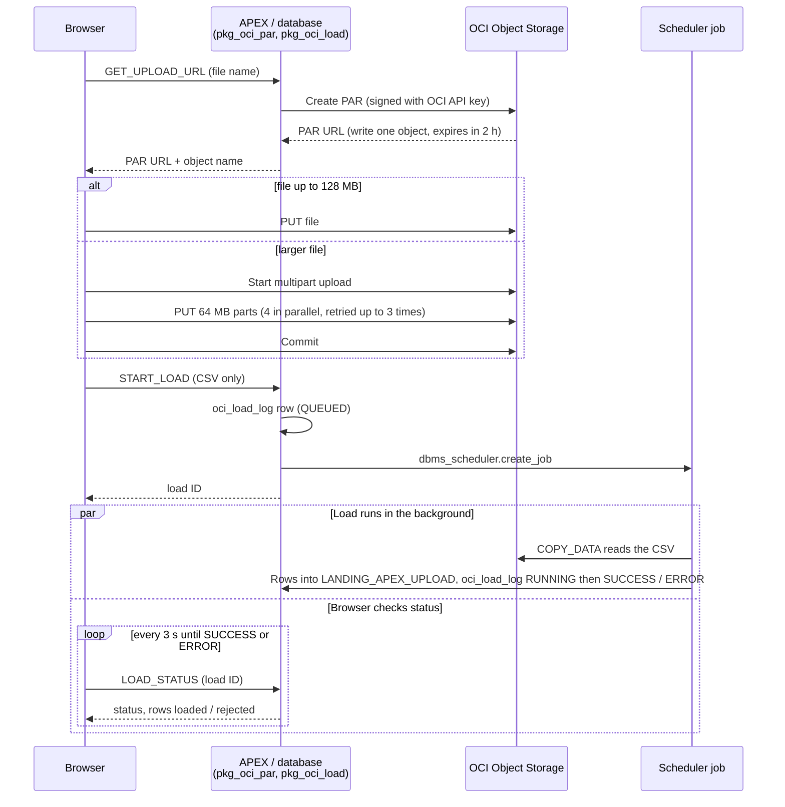

# APEX large-file upload to OCI Object Storage

Upload multi-GB files from an Oracle APEX page **straight to OCI Object Storage**, then load
CSVs into Autonomous Database automatically, with live progress, a load audit log, and
rejected-row drill-down.

The file never passes through APEX or the database on the way up. APEX only issues a
short-lived, single-object [pre-authenticated request](https://docs.oracle.com/en-us/iaas/Content/Object/Tasks/usingpreauthenticatedrequests.htm)
(PAR). The browser uploads to it directly, in parallel parts for large files. When a CSV
lands, a background job runs `DBMS_CLOUD.COPY_DATA` from the bucket into a table.

> **Credit:** the pre-authenticated request code builds on Jon Dixon's
> [Using OCI Pre-Authenticated Requests with APEX](https://blog.cloudnueva.com/apex-oci-par)
> (Cloud Nueva). Thanks, Jon!


## Results from testing

| Test | Result |
|---|---|
| 856 MB CSV, 6.5 million rows | Upload 5 min 41 s (2.5 MB/s, limited by the uploader's connection) · **load into ATP 23 s** · 0 rejected |
| 1 GB binary file | Multipart upload, 16 × 64 MB parts, 7 min 6 s |
| 1,000-row CSV with 3 bad rows | 997 loaded, 3 rejected and shown with the reason for each |
| PGP-encrypted upload, 1,000-row CSV | Bucket holds ciphertext only (15% of original size); decrypts to a byte-for-byte identical file |
| PGP encryption, 856 MB CSV (outside the browser, same code path) | 125 MB of ciphertext (14.6%), ~77 MB/s, memory stays around 100–140 MB |

Upload time depends on the user's connection. Once a file is in the bucket, the database
loads millions of rows in seconds.

## How it works



**Features**

- Drag-and-drop upload with a two-step tracker (upload → load) and a progress bar
- Files over 128 MB upload as 64 MB parts, 4 in parallel, each retried up to 3 times;
  a failed upload is aborted so no partial object is left
- CSVs load automatically in a background job, so long loads don't hit APEX request timeouts
- `oci_load_log` audits every load and every failed upload; stuck or dead jobs are detected
- Rejected rows are kept, with a dialog showing each bad line and why it was rejected
- Loaded Records page with KPI cards that follow the report's filters
- Optional **PGP encryption in the browser**: files are compressed and encrypted with your
  public key before upload, so the bucket only ever holds ciphertext
- Test data generator for files of any size, with deliberate bad rows if you want them

## Repository layout

```
apex-app/                  APEX application, APEXlang format (APEX 26.1)
  pages/                   4 PAR Upload · 5 Rejected Rows (modal) · 6 Loaded Records · 9999 Login
  shared-components/static-files/par_upload.js, par_upload.css
db/
  install.sql              runs everything below in order
  pkg_oci_par.sql/.plb     creates PARs (configure namespace, bucket, region, credential here)
  pkg_oci_load.sql/.plb    background CSV load, status, rejects (configure DBMS_CLOUD credential here)
  oci_load_log.sql         load / upload audit table
  landing_apex_upload.sql  target table (sample AP-invoice layout)
  t_kpi_types.sql          row type for the KPI cards
  get_invoice_kpis.sql     KPIs for the Loaded Records page
  uninstall.sql
tools/make_test_csv.py     test CSV generator
tools/pgp_verify.sh        proves a PGP upload round trip (ciphertext in bucket, identical after decrypt)
docs/manual-page-build.md  build the pages by hand instead of importing
```

## Prerequisites

- **Oracle Autonomous Database** with APEX. Tested on APEX **26.1**; the export uses
  the APEXlang format, which needs 26.1 or later. The database code is plain PL/SQL and
  `DBMS_CLOUD`, so it also works on older versions if you
  [build the pages by hand](docs/manual-page-build.md).
- An **OCI Object Storage bucket**.
- An **OCI IAM user with an API signing key**. The PAR call must be signed, so an auth
  token won't do.
- The schema needs **`CREATE JOB`**. Autonomous Database schemas usually have it.
- Python 3.9+ to generate test data (optional).

## Setup

### 1. OCI: API key and policy

1. Pick an IAM user (ideally a dedicated service user) and add an **API key**: Profile →
   Tokens and keys → Add API key → Generate API key pair → **download the private key**.
   Note the user OCID, tenancy OCID and fingerprint from the configuration preview.
2. Allow that user's group to manage objects in the bucket. This includes `PAR_MANAGE`:

   ```
   Allow group <group> to manage objects in compartment <compartment>
     where target.bucket.name = '<your_bucket>'
   ```

### 2. Credentials

**APEX Web Credential, used to create PARs.** In the workspace: App Builder → Workspace
Utilities → Web Credentials → Create.

| Field | Value |
|---|---|
| Name / Static ID | `OCI_NATIVE_CRED` (or change `pkg_oci_par.gc_credential`) |
| Authentication Type | OCI Native Authentication |
| OCI User ID / Tenancy ID / Fingerprint | from step 1 |
| OCI Private Key | the whole `.pem` file, including the `BEGIN`/`END` lines, with no passphrase |
| Valid for URLs | `https://objectstorage.<region>.oraclecloud.com/` |

**DBMS_CLOUD credential, used by `COPY_DATA` and `LIST_OBJECTS`.** Run as the parsing schema:

```sql
begin
  dbms_cloud.create_credential(
    credential_name => 'OBJ_STORE_CRED',          -- or change pkg_oci_load.gc_credential
    username        => '<oci_username>',
    password        => '<auth_token>');           -- Profile > Tokens and keys > Auth tokens
end;
/
```

An API-key DBMS_CLOUD credential (`user_ocid`, `tenancy_ocid`, `private_key`,
`fingerprint`) works too.

### 3. Install the database objects

Edit the **CONFIGURE** sections first:

| File | Constant | Example |
|---|---|---|
| `db/pkg_oci_par.sql` | `gc_namespace` | your Object Storage namespace (Tenancy details) |
| | `gc_bucket_name` | `my-upload-bucket` |
| | `gc_base_url` | `https://objectstorage.us-ashburn-1.oraclecloud.com` |
| | `gc_credential` | `OCI_NATIVE_CRED` (the Web Credential static ID) |
| `db/pkg_oci_load.sql` | `gc_credential` | `OBJ_STORE_CRED` (the DBMS_CLOUD credential) |

Then, from SQLcl or SQL*Plus:

```
cd db
sql <user>@<tns_alias> @install.sql
```

Or, in SQL Workshop → SQL Scripts, run the files in the order listed in `install.sql`.
If you already have `T_KPI_ROW`/`T_KPI_TAB`, skip `t_kpi_types.sql`.

**Smoke test** (SQL Workshop → SQL Commands; the Web Credential needs an APEX session):

```sql
declare
  l_obj varchar2(1000);
  l_url varchar2(2000);
begin
  pkg_oci_par.get_upload_url('test.txt', 15, l_obj, l_url);
  dbms_output.put_line(l_url);
end;
```

Then `curl -i -X PUT --data-binary @test.txt "<url>"` should return `HTTP/1.1 200 OK`.

### 4. Install the APEX app

`apex-app/` is an APEXlang export (`.apx` files). Import it into your workspace with
APEX 26.1+ tooling: SQLcl 26.1.2 or later, or the Oracle SQL Developer extension for VS
Code. Follow Oracle's APEXlang documentation for the import command for your version.
For reference, this is how an app is exported in this format:

```
apex export -applicationid <id> -exptype APEXLANG -split -dir <parent-dir>
```

Notes:

- `deployments/default.json` sets application ID **157**. Change it if that ID is taken.
- The app uses **Oracle APEX Accounts** sign-in. Create a workspace user, or switch the
  authentication scheme to your own.
- After importing, regenerate the session state protection salt: Shared Components →
  Security Attributes → Session State Protection.
- The credentials from step 2 are workspace components and aren't part of the export.

If you can't import the APEXlang format, [build the three pages by hand](docs/manual-page-build.md).

## How to use

1. Open **PAR Upload**. Drag a file onto the drop zone or click to browse, then click **Upload**.
2. **Upload to Object Storage** fills the progress bar. Large files go up in parts; the
   status line shows MB sent and, when done, the time and MB/s.
3. For a `.csv`, **Load into ATP** starts automatically and the bar animates while
   the job runs. The status line then shows rows loaded and rejected, plus the total time.
   Other file types only upload.
4. **Load History** lists every load. Click the **Rows Rejected** number to see each
   rejected line and its reason, for example `INVOICE_DATE - ORA-01843: not a valid month`.
5. **Loaded Records** shows the table in an Interactive Report, with KPI cards (invoices,
   total spend, average and largest invoice, vendors, days to GL) that follow its filters.

### Test data

```bash
python tools/make_test_csv.py --rows 1000 --bad 3      # quick check: 3 rows will be rejected
python tools/make_test_csv.py --size-mb 1024           # ~1 GB, ~7.8 M rows
```

Files are written to your Downloads folder. The script prints the expected row count and
amount total so you can reconcile:

```sql
select count(*), sum(invoice_amount) from landing_apex_upload;
```

### Loading your own CSV layout

1. Change `db/landing_apex_upload.sql` to your columns, **in the same order as the CSV**.
   `COPY_DATA` maps fields by position.
2. Adjust `dateformat`/`timestampformat` in `pkg_oci_load.run_load` if your dates differ.
3. Change or remove `get_invoice_kpis` and the Loaded Records page to suit.

Each load **truncates** the target table first, like a landing table. To append instead,
remove the `truncate` in `run_load`.

## Optional: PGP encryption in the browser

HTTPS already encrypts every upload in transit, and OCI encrypts stored objects. PGP adds
that the stored file is **unreadable to anyone with bucket access** unless they hold your
private key, which is what many PII file-transfer policies ask for.

With **Encrypt with PGP before upload** ticked, the browser gzips the file in 1 MB blocks,
encrypts it with [OpenPGP.js](https://openpgpjs.org/) using your **public** key, and uploads
the ciphertext as `<name>.gz.pgp`. Large files still stream in parts with bounded memory.
CSVs shrink a lot when compressed, so encrypted uploads are usually much faster.

> Encrypted files are **not loaded into the database**: that needs server-side decryption
> (for example an OCI Function holding the private key in OCI Vault), which this repo
> doesn't include yet. The "Load into ATP" step shows as skipped for encrypted uploads.

**Setup**

1. Create a key pair (or use your organization's). For a test key with GnuPG:

   ```bash
   gpg --quick-gen-key "PAR Upload test key <you@example.com>" default default 1y
   gpg --armor --export you@example.com > pgp_public_key.asc
   ```

   Keep the **private** key off the server and out of the app. Only the public key is uploaded.
2. Upload `pgp_public_key.asc` to Shared Components → Static Application Files.
3. The page already loads OpenPGP.js 6.3.2 from jsDelivr before `par_upload.js`. To avoid
   the CDN, upload `openpgp.min.js` as a static file and point the File URL at it.
4. Tick the box on the upload page. It's unticked by default.

**Prove it**

Create a short-lived read URL for the uploaded object (SQL Commands):

```sql
begin
  dbms_output.put_line(pkg_oci_par.generate_pre_auth_request(
    'MINUTE', 15, 'ObjectRead', 'apex_uploads/<object>.csv.gz.pgp'));
end;
```

Then, in Git Bash or any shell with `gpg` (set `GNUPGHOME` if your key isn't in the default keyring):

```bash
tools/pgp_verify.sh "<read URL>" path/to/original.csv
```

It shows the stored bytes are binary ciphertext, decrypts with your private key, and
compares checksums with the original. To decrypt by hand: `gpg -d file.csv.gz.pgp | gzip -dc > file.csv`

**Why the file is gzipped first:** OpenPGP.js's built-in compression reads the whole input
into memory when the upload is slower than encryption, which it always is. Compressing 1 MB
blocks with the browser's native `CompressionStream` and turning OpenPGP compression off keeps
memory bounded. The result is a standard multi-member gzip that `gzip`, zlib and Python
read as one file.

## Configuration reference

| Setting | Where | Default |
|---|---|---|
| PAR lifetime | `pkg_oci_par.get_upload_url` `p_expiry_minutes` | 120 min |
| Upload folder | `pkg_oci_par.gc_upload_prefix` | `apex_uploads/` |
| Target table | `pkg_oci_load.gc_target_table` | `LANDING_APEX_UPLOAD` |
| Bad rows allowed before the load fails | `pkg_oci_load.gc_reject_limit` | 100 |
| Part size / multipart threshold / parallel parts / retries | top of `par_upload.js` | 64 MB / 128 MB / 4 / 3 |
| Encrypted part size / gzip block size | `ENC_PART_SIZE` / `ENC_BLOCK_SIZE` in `par_upload.js` | 16 MB / 1 MB |
| PGP public key | `publicKeyUrl` option on the Upload button | `#APP_FILES#pgp_public_key.asc` |
| Status poll interval / give-up time | top of `par_upload.js` | 3 s / 60 min |

## Troubleshooting

| Symptom | Cause / fix |
|---|---|
| `ORA-20111 ... (HTTP 401)` from GET_UPLOAD_URL | Web Credential key, fingerprint or OCIDs are wrong, or the API key was deleted |
| `ORA-20111 ... (HTTP 404)` or `(HTTP 403)` | The IAM user lacks `manage objects` / `PAR_MANAGE` on the bucket, or the namespace or bucket name is wrong |
| `PUT failed: network error` with no HTTP status | Connectivity or CORS. OCI returns permissive CORS headers for PAR requests, so this is usually the network or an expired PAR |
| "OpenPGP.js is not loaded on this page" | The OpenPGP.js File URL is missing or listed after `par_upload.js` |
| "Could not load the PGP public key (HTTP 404)" | `pgp_public_key.asc` isn't uploaded as a static application file |
| `... is not a function` in the browser console | The browser is using a cached old `par_upload.js`. Bump `?v=N` on the page's File URL |
| Load stays QUEUED | The scheduler job couldn't start (check `CREATE JOB`). The page's status check marks dead jobs as ERROR |
| Rejected Rows says "no longer available" | The `COPY$n_LOG`/`COPY$n_BAD` tables were dropped (`dbms_cloud.delete_all_operations`) |

Where errors are recorded:

```sql
-- Loads and failed uploads
select * from oci_load_log order by load_id desc;

-- Scheduler outcomes
select job_name, status, errors, actual_start_date
from user_scheduler_job_run_details
where job_name like 'OCI_LOAD_%'
order by actual_start_date desc;

-- PAR creation errors
select message_timestamp, message
from apex_debug_messages
where message like 'generate_pre_auth_request%'
order by message_timestamp desc;
```

## Security notes

- A PAR lets **anyone holding the URL write that one object** until it expires. It's issued
  only to a signed-in APEX session, for one timestamped object name, and expires after
  2 hours by default. Shorten `p_expiry_minutes` if your files are small.
- Uploaded files aren't scanned. Treat the upload folder as untrusted input.
- Use a dedicated IAM user whose policy covers only this bucket.
- The **Truncate** button on Loaded Records deletes all loaded rows. Remove it or protect
  it with an authorization scheme outside of demos.
- `COPY$n_LOG`/`COPY$n_BAD` tables accumulate. Clean them up periodically with
  `dbms_cloud.delete_all_operations('COPY')`.
